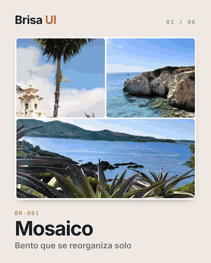

# Brisa UI

Componentes animados de código abierto para WordPress, con luz mediterránea.
Funcionan en **Elementor** y en el **editor de bloques de WordPress (Gutenberg)**, y también en Astro o en HTML suelto.

Sin plugins: copias la pieza, la pegas, y el código queda en tu web. Las fotos se eligen con la galería normal de WordPress, sin tocar código.

Hecho en Dénia por [Marina Code](https://www.marinacode.dev/brisa/) · Licencia MIT

<p align="center"></p>

**[Ver las demos en vivo y descargar →](https://www.marinacode.dev/brisa/#piezas)**

## Piezas

| Código | Pieza | Qué hace |
|---|---|---|
| BR-001 | Mosaico | Bento con marco fijo: las celdas crecen, se parten y se relevan |
| BR-002 | Marea | Dos filas de fotos que corren en sentidos opuestos |
| BR-003 | Persianas | Tres columnas en movimiento vertical, la central a contracorriente |
| BR-004 | Baraja | Pila de postales: la de delante sale con un giro y vuelve al fondo |
| BR-005 | Abanico | Paneles que se abren uno tras otro |
| BR-006 | Ensamblaje | Las fotos llegan dispersas y encajan al hacer scroll |
| BR-007 | Cascada | Columna de tarjetas que sube a tirones: se enderezan al moverse y vuelven a inclinarse, alternando lados, sobre un texto gigante |
| BR-008 | Rodillo | Tambor vertical: la del centro queda plana y las demás se doblan hacia atrás |
| BR-009 | Anillo | Aro horizontal de fotos que gira, visto un poco desde arriba |
| BR-010 | Corona | Círculo de fotos que gira despacio y se balancea en 3D |

## Usarlas

Descarga el `.zip` de la pieza en [marinacode.dev/brisa](https://www.marinacode.dev/brisa/#piezas) o en `dist/`. Dentro tienes:

- `…-elementor.json`: plantilla para importar en Elementor.
- `…-gutenberg.txt`: bloques para pegar en el editor de WordPress.
- `….html`: el código suelto.
- `LEEME.md`: la guía paso a paso.

## Cómo está hecho

```
core/brisa.js          Motor común de todas las piezas (sin dependencias)
core/brisa.css         Estilos comunes
core/fotos-prueba.json Fotos de prueba que se ven mientras no hay galería
piezas.json            Definición de cada pieza (nombre, tamaño, ritmo)
plantillas/            Guía que acompaña a cada pieza
build.py               Genera dist/ con todos los envoltorios
```

Para generar las piezas: `python3 build.py`

### Decisiones que conviene conocer

- **El código va codificado en un atributo del `<div>`** y un cargador mínimo lo ejecuta. Así no lo rompen los filtros de texto de WordPress, que cambian las comillas, ni la forma en que el editor de Elementor vuelve a ejecutar los `<script>`.
- **La altura se fija por JavaScript** según el ancho real. En los contenedores flex de Elementor, `aspect-ratio` no reserva hueco porque todas las celdas son absolutas.
- **Cada pieza usa la galería que tiene justo debajo**, hasta la siguiente pieza. Solo la primera pieza de la página puede usar una galería colocada encima.
- **Siempre usa la foto original**: quita el sufijo `-150x150` que añade WordPress.

## Contribuir

Las propuestas de piezas nuevas y los avisos de errores son bienvenidos. Abre una incidencia describiendo tu editor (Elementor o Gutenberg), tu tema y lo que ves.
